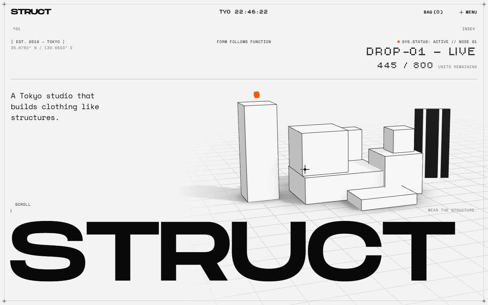

# STRUCT



## About

STRUCT is a fictional clothing studio based in Tokyo, with studios in Osaka, Seoul, Singapore, London, Paris, New York and Los Angeles. Its tagline is **Form follows function**.

The studio was founded in 2019 by four people from four different disciplines (architecture, pattern cutting, textiles and type) who quit design jobs in the same week. They disliked design that decorates, so they built their own method: draw only where the load travels, and cut everything that does not carry. They call it Kozo, the Japanese word for structure.

The brand sells in two ways:

- **DROP-01** is a drop of eight individual garments, 100 units each, released once and never restocked.
- **SUIT-01** is a separate product: a full black or white suit (coat, tunic, trouser and belt) that is sold whole, never as separate parts, in men's and women's cuts.

This is a design project. The brand, people, places and numbers are invented, the imagery is AI-generated, and the shop takes no payment and ships nothing.

## Pages

| Route | Description |
|---|---|
| `/` | Preloader, hero, principles, method, journey, DROP-01 garments, nodes globe and the SUIT-01 reveal |
| `/drop-01` | The eight garments, with filters, quick add and product pages |
| `/suit-01` | The whole-body suit in four variants, with product pages |
| `/people` | The four founders, studio rules and crew |

## Tech stack

- Next.js 16 (App Router) with React 19 and TypeScript
- Tailwind CSS 4
- GSAP (ScrollTrigger, SplitText, Flip) for animation
- Lenis for smooth scrolling
- three.js, React Three Fiber and drei for the 3D scenes
- cobe for the dotted globe
- Zustand for the bag and UI state
- Fonts: Monument Extended, Bitcount and Space Mono

## Running locally

```bash
npm install
npm run dev
```

Then open http://localhost:3000. To check a production build, run `npm run build`.

## Project notes

- `docs/BRAND.md` covers the story, identity, colours, type and motion.
- `docs/CHANGE-02.md` explains how DROP-01 and SUIT-01 differ.
- `docs/ARCHITECTURE.md` describes how the code is organised.
- `docs/CREDITS.md` lists libraries and licences.
